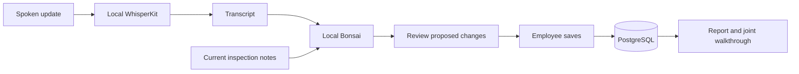

# Nimbus

**Speak your inspection. Make the next shift's handoff clear.**

Nimbus is a local voice-assisted workspace for aircraft inspections and shift
handovers. Describe what you found, review the drafted task, and walk the next
employee through anything unfinished—all without cloud AI.

[Why Nimbus](#why-nimbus) · [Features](#what-nimbus-does) · [Models & tools](#models--tools) · [Architecture](#architecture) · [Quick start](#quick-start)

## Why Nimbus

A shift ends with work still in progress: a cover is off, a part is waiting to be
replaced, or a check remains unfinished. The next employee needs more than “not
done.” They need to know the current condition, what has already happened, and
what they should check or do next.

Nimbus helps turn short spoken updates into structured inspection notes. Before
handoff, it looks for unresolved safety-related information gaps. The incoming
employee then reviews the report and acknowledges the items they are taking over.

**AI drafts the notes. Employees review, save, and acknowledge them.**

## What Nimbus does

### 1. Sign in and choose an aircraft

- Six-digit employee PINs, checked by the backend.
- Aircraft access limited to each employee's assignments.
- A shift board showing task progress, follow-up items, and handoff history.

### 2. Speak, review, and save an inspection

- Starts listening when an inspection opens, with a visible indicator and cancel control.
- Turns speech into editable findings, work performed, stopping point, and next action.
- Chooses from 39 ATA aircraft-system chapters and highlights the system on a 3D aircraft.
- Asks up to two clarification questions in one round when necessary.
- Shows proposed changes before applying them. **Save inspection** persists the task.

### 3. Prepare the handoff

- Reviews saved notes for unresolved safety concerns—not routine wording questions.
- Asks at most three questions in one round; clear notes may need none.
- Reads questions aloud and lets you answer the whole set in one recording or by typing.
- Shows any proposed task updates before saving them and building the report.

### 4. Hand over together

- Verifies the incoming employee's PIN.
- Presents follow-up work first, with the current condition and next action.
- Records acknowledgments and any questions resolved together.
- **Confirm handover & log out** completes the record before ending the outgoing session.

## Models & tools

| Role | Technology | Runs where? |
| --- | --- | --- |
| Speech to text | Argmax OSS WhisperKit / Core ML | Apple Silicon Mac; model stays loaded between recordings |
| Form drafting and safety questions | Bonsai, configured as `bonsai-9b` | Local inference server |
| Reading questions aloud | Browser speech synthesis | Local English device voices only |
| Interface and aircraft model | React, TypeScript, Material UI, Three.js, Vite | Browser |
| API and data | FastAPI, SQLAlchemy, PostgreSQL, Alembic | Local backend and database |

**No cloud AI or cloud AI API key is needed for this setup.** Models and dependencies
must be installed first. Inference then uses local services; there is no cloud
fallback. Manual inspection editing works without AI, but the current Prepare
handoff screen requires Bonsai for its automated review.

## Architecture



WhisperKit transcribes; Bonsai drafts. Neither saves an inspection on its own.
The backend enforces aircraft access, validates output, and prevents stale handoff
previews from overwriting newer task notes.

## Quick start

Requires **Node.js 22.12+**, **Python 3.13**, **Pipenv**, and **PostgreSQL**.
Local WhisperKit additionally requires an Apple Silicon Mac and the Swift toolchain.

### Backend

From the repository root:

```sh
createdb -h localhost -U postgres nimbus
cp -n backend/.env.example backend/.env
```

Edit `backend/.env` with your PostgreSQL credentials and your own six-digit
`SEED_HOM_PIN` and `SEED_PEACH_PIN`. There are no default PINs.

```sh
cd backend
PIPENV_VENV_IN_PROJECT=1 pipenv install --dev
pipenv run alembic upgrade head
pipenv run dev
```

### Frontend

In another terminal, from the repository root:

```sh
cd frontend
npm ci
npm run dev
```

Open **http://localhost:5173**. API documentation is at **http://127.0.0.1:8000/docs**.
The seed includes Hom, Peach, three aircraft, and eleven demonstration tasks.
Both employees can access N417HD and N288HD for a complete handoff demo.

### Local AI

Build and configure [the WhisperKit bridge](tools/whisperkit/README.md), then run
a compatible local Bonsai server. Set its address in `backend/.env`:

```dotenv
BONSAI_BASE_URL=http://127.0.0.1:18080/v1
BONSAI_MODEL=bonsai-9b
```

Model weights are not bundled. For speech asset paths, complete setup instructions,
a walkthrough, and troubleshooting, see the [developer guide](docs/DEVELOPMENT.md).

## Design decisions and current limits

- **Keep speech ready:** a persistent Swift worker avoids loading WhisperKit for every clip.
- **Keep changes reviewable:** proposed edits are separate from saved records.
- **Ask fewer questions:** inspection clarification is limited to one round; handoff review focuses on safety-related gaps.
- **Preserve unfinished work:** completing a handoff does not mark its tasks done.
- **Use ATA as a category:** 3D highlights are representative system areas, not exact aircraft-specific component locations.
- **Do not invent manual requirements:** Nimbus sees recorded manual references but does not currently retrieve AMM content.

Nimbus is a demonstration with synthetic records, not a maintenance approval or
airworthiness system. An empty safety-question list is not a safety certification.

## Development

```sh
# From the repository root
npm run lint --prefix frontend
npm run build --prefix frontend

# Backend
cd backend
pipenv run lint
```

To restore the demo data, run `pipenv run python reseed.py` from `backend` with both
seed PINs configured. **This deletes current tasks, handoffs, custom data, and sessions.**

See [the developer guide](docs/DEVELOPMENT.md) for the code map, API overview,
database migrations, recovery behavior, verification notes, and troubleshooting.
