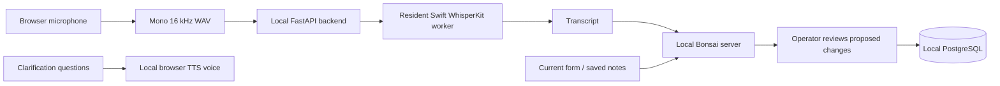

# Nimbus — setup and developer guide

[← Project overview](../README.md)

**A local voice-assisted aircraft inspection and shift-handoff workspace.**

Nimbus helps employees capture what they found, record what they did, and hand
unfinished work to the next shift. It turns spoken updates into editable
inspection drafts, checks saved notes for unresolved safety handoff gaps, and
records a walkthrough between outgoing and incoming employees.

**Nimbus uses no cloud AI in its configured workflow.** Speech recognition runs
through Argmax OSS WhisperKit on Apple Silicon. Form drafting and safety-question
generation run through a local Bonsai model server. Questions can be read aloud
using a local browser voice. Model output is reviewed before it changes a record.

This is a demonstration application with synthetic maintenance records. It
records reported work; it does not verify that maintenance was performed, approve
an aircraft for service, or replace an applicable Aircraft Maintenance Manual (AMM).

## Start here

Nimbus addresses a simple shift-change problem: the person taking over needs to
know **what was found, what changed, what is still unfinished, and what to do next**.
The app keeps those facts attached to the aircraft and its inspection tasks.
Voice is an input shortcut; the saved task and reviewed handoff remain the record.

| You want to… | Start with… |
| --- | --- |
| Understand the product | [Workflow](#what-the-app-does) and [example walkthrough](#example-walkthrough) |
| Run the app | [Core setup](#quick-start-core-application), then [local AI setup](#enable-local-speech-and-bonsai) |
| Understand the privacy boundary | [Local AI, not cloud AI](#local-ai-not-cloud-ai) |
| Change model behavior | [Reasoning rules](#how-inspection-and-handoff-reasoning-works) and [code map](#code-map) |
| Reset the demonstration | [Database maintenance](#database-maintenance) |
| Investigate a problem | [Troubleshooting](#troubleshooting-and-verification) |

### Terms used in this project

| Term | Plain-English meaning |
| --- | --- |
| Work item / inspection card | One finding or maintenance task attached to an aircraft. |
| Shift board | The aircraft's list of tasks, progress, and follow-up work. |
| Handoff / handover | The recorded transfer of task information from one employee to another. |
| Outgoing / incoming employee | The employee ending their shift / the employee taking over. |
| ATA chapter | A numbered aircraft-system category, such as 33 for lights. It is not an exact component address. |
| AMM | Aircraft Maintenance Manual: aircraft-specific procedures and requirements. Nimbus does not currently retrieve it. |
| WhisperKit / speech-to-text | The local model that converts audio into written words. |
| Bonsai / language model | The local model that turns words into form drafts and identifies safety-related information gaps. |
| TTS / text-to-speech | Reading written questions aloud using a local device voice. |
| Migration / seed data | A versioned database change / the initial example employees, aircraft, and tasks. |

## What the app does

1. **Sign in.** Select Hom or Peach and enter a six-digit employee PIN.
2. **Choose an aircraft.** Employees see only aircraft assigned to them.
3. **Review the shift board.** See progress, items needing follow-up, and saved
   handoff history. Open an existing task or select **+ New work item**.
4. **Capture an inspection.** Nimbus starts listening when the page opens, subject
   to browser microphone permission. Stop to process the recording, cancel to
   discard it, or edit the form manually. Recovered drafts do not auto-record.
5. **Review the draft.** Bonsai proposes changes to the form and an ATA chapter.
   Review the before/after values, apply them to the draft, then **Save inspection**.
6. **Prepare handoff.** From the progress panel, ask Nimbus to review the saved
   tasks for unresolved safety-related handoff gaps. It may ask zero to three
   questions in one round. Answer by typing or recording the whole set together.
7. **Approve task updates.** Review proposed changes resulting from those answers.
   Approval saves the exact reviewed updates and creates a handoff snapshot.
8. **Hand over together.** Verify the incoming employee's PIN, discuss and
   acknowledge required follow-up items, then **Confirm handover & log out**.
   Completion must succeed before logout proceeds.

The report puts follow-up work first, with the current condition, next action,
and acknowledgment state. Completed work is collapsed. Previous reports remain
available from the aircraft board.

## Example walkthrough

Use synthetic data only for this demonstration. Start the backend, frontend,
WhisperKit assets, and Bonsai server before trying the complete voice flow.

1. Sign in as **Hom** using the seed PIN you configured and choose **N417HD**.
2. Click **+ New work item**. The microphone starts after permission is granted.
3. Say: “The right landing light is not working. I inspected the lens and found
   a crack. I have not replaced it. Replacement is pending for the next shift.”
4. Stop recording. Nimbus transcribes the update and proposes an inspection card.
   Inspect the proposed title, finding, work performed, stopping point, next
   action, and **ATA 33 · Lights**. The 3D highlight represents the system.
5. Apply the proposed changes, correct anything necessary, and save the inspection.
   Applying a draft alone does not save it.
6. Return to the board and click **Prepare handoff** in the progress panel. Nimbus
   may ask a safety-related question if the saved notes leave a relevant gap;
   it should not ask again whether replacement is pending.
7. If questions appear, answer them together in one recording or type into the
   answer fields. Review and approve any proposed task updates.
8. On the final report, select **Peach** and enter Peach's PIN. Review each required
   follow-up item together and acknowledge it. This records understanding, not
   completion of the maintenance task.
9. Choose **Confirm handover & log out**. Sign in as Peach and open the same
   aircraft to see the carried-forward task and saved handoff history.

Model wording may vary. Check the recorded facts rather than expecting identical
sentences. The example does not prescribe a maintenance procedure or a test.

### What gets saved, and when?

| Action | Effect |
| --- | --- |
| Record or type an update | Supplies input; does not save an inspection. |
| Fill form with Bonsai | Proposes changes or clarification questions. |
| Use these changes | Applies a proposal to the editable, unsaved form. |
| Save inspection | Writes the task to PostgreSQL. |
| Record handoff answers | Fills editable answer fields; does not change saved tasks. |
| Review changes | Creates a proposed update preview; original tasks remain unchanged. |
| Approve changes & build report | Saves the reviewed updates and a handoff snapshot together. |
| I understand | Records the incoming employee's acknowledgment of an item. |
| Confirm handover & log out | Confirms and completes the handoff, then ends the outgoing session. |

## Local AI, not cloud AI



| Component | Role | Where it runs |
| --- | --- | --- |
| React, Material UI, Three.js | Forms, boards, reports, aircraft visualization | Browser |
| FastAPI | Authentication, authorization, persistence, model orchestration | Local Python backend |
| PostgreSQL | Employees, assignments, inspections, sessions, handoffs | Local database by default |
| Argmax OSS WhisperKit | Speech to text | Swift/Core ML on the Mac |
| Bonsai | Drafting, ATA selection, safety questions, answer mapping | Local OpenAI-compatible inference server |
| Browser speech synthesis | Reads questions aloud | Local English voices only |

Bonsai and optional Argmax Pro URLs are restricted to loopback hosts by the
backend. The OSS bridge uses existing model/tokenizer files, disables downloads,
and blocks unexpected HTTP(S) tokenizer fallback. No Pro key is needed for OSS.
Dependencies and model assets must be obtained during setup; local inference does
not mean the initial installation needs no downloads.

**Without AI:** sign-in, assigned-aircraft access, boards, manual inspection
editing/saving, ATA selection, the 3D view, and saved handoff history still work.
Voice transcription needs WhisperKit; drafting and automated review need Bonsai.
The current **Prepare handoff UI requires Bonsai** to complete its review step;
it does not yet provide an AI-free bypass. Typed form editing is independent of
Bonsai, but “Fill form with Bonsai” is not.

## Quick start: core application

There are two setup stages. First run the web application and database; this is
enough to sign in and edit inspections manually. Then add local speech/model
services for the complete voice-assisted workflow. You do not need a cloud AI
account or API key for the configured OSS setup.

Requirements:

- Node.js **22.12+** and npm.
- Python **3.13**, Pipenv, and PostgreSQL.
- Apple Silicon and the Swift toolchain for the optional OSS speech pipeline.

Run commands from this repository unless a different directory is shown.

### 1. Configure PostgreSQL and seed PINs

Create the database if it does not already exist:

```sh
createdb -h localhost -U postgres nimbus
```

Copy configuration only if you do not already have `backend/.env`:

```sh
cp -n backend/.env.example backend/.env
```

Edit `backend/.env`:

```dotenv
POSTGRES_SERVER=localhost
POSTGRES_PORT=5432
POSTGRES_DB=nimbus
POSTGRES_USER=postgres
POSTGRES_PASSWORD=your_local_database_password
BASE_URL=http://localhost:5173
SESSION_HOURS=12

# Choose your own six-digit values; there are no default employee PINs.
SEED_HOM_PIN=
SEED_PEACH_PIN=
```

Both seed PINs are required on the initial migration. Leading zeros are supported.
The database stores salted scrypt hashes, not plaintext PINs. Changing seed values
later does not change existing users' PINs. You may clear the seed values after
setup; supply them again before a full reseed. Never commit `.env`.

### 2. Install and run the backend

```sh
cd backend
PIPENV_VENV_IN_PROJECT=1 pipenv install --dev
pipenv run alembic upgrade head
pipenv run dev
```

API: <http://127.0.0.1:8000> · Interactive API docs: <http://127.0.0.1:8000/docs>

If speech assets are not configured, background WhisperKit warmup can log a
warning. That does not block ordinary database-backed routes or manual editing.

### 3. Install and run the frontend

In a separate terminal:

```sh
cd frontend
npm ci
npm run dev
```

Open <http://localhost:5173>. Vite forwards `/api` to `127.0.0.1:8000`.
For a separately hosted frontend, set `VITE_API_URL` to the backend URL including
`/api/v1`, and set backend `BASE_URL` to the frontend origin. A production frontend
host must serve `index.html` for application routes so deep links and refresh work.

### Seeded demo data

Applying all migrations creates two employees, three aircraft, and eleven sample
work items. Assignments after the complete migration chain are:

| Employee | Assigned aircraft |
| --- | --- |
| Hom | N417HD, N288HD |
| Peach | N417HD, N288HD, N903HD |

Hom and Peach can hand N417HD or N288HD to each other. N903HD demonstrates restricted
assignment access. The incoming employee must be active, assigned to the aircraft,
and different from the outgoing employee.

## Enable local speech and Bonsai

### WhisperKit

See [the Swift bridge setup guide](../tools/whisperkit/README.md) for the cached
SwiftPM checkout requirements and model/tokenizer layout. Its default source path
references the original developer's sibling project; set your own source path on
a fresh machine. The repository does not bundle speech model weights.

```sh
export WHISPERKIT_SOURCE_PATH=/absolute/path/to/argmax-oss-swift
./tools/whisperkit/build.sh
```

Configure `backend/.env` with absolute paths:

```dotenv
SPEECH_PROVIDER=whisperkit
WHISPERKIT_BINARY_PATH=/absolute/path/to/plane-handoff/tools/whisperkit/.build/release/nimbus-whisperkit
WHISPERKIT_MODEL_PATH=/absolute/path/to/cached/whisper-model
WHISPERKIT_TOKENIZER_PATH=/absolute/path/to/cached/tokenizer
```

`WHISPERKIT_SOURCE_PATH` is a build-time shell variable, not a runtime model path.
Restart the backend after rebuilding or changing configuration.

The backend starts the Swift worker in the background and keeps the model loaded
between recordings. It processes clips sequentially through private stdin/stdout
pipes; no separate speech server port is needed. Cancelled requests, crashes,
timeouts, and malformed replies discard the worker; the next request restarts it.
Backend shutdown releases the worker. Use one backend process for this station
setup—each process would load its own model.

Recordings are limited to 90 seconds and converted to mono 16 kHz WAV. Temporary
backend audio is deleted after processing. Cancelling recording discards the clip.
The first recording can wait for initial loading, but later clips reuse the model.

### Bonsai

Run a compatible local inference server with your Bonsai model loaded, then set:

```dotenv
BONSAI_BASE_URL=http://127.0.0.1:18080/v1
BONSAI_MODEL=bonsai-9b
```

The server must support `/chat/completions` and the JSON response format used by
the backend. Nimbus calls the server; it does not install model weights or start
that server. The model name must match your server configuration. The original
setup used `llama-server`; a sibling project's launcher is not included here.

The optional Pro adapter remains under [tools/argmax](../tools/argmax), but the
configured workflow uses OSS WhisperKit. An `axst_` SDK-download token and an
`ax_` Pro runtime key are different credentials; neither is needed for OSS.

### Reading questions aloud

Inspection clarifications and handoff safety questions are automatically read
when a local English browser voice is available. **Read questions** replays them;
**Stop reading** cancels speech. Recording pauses read-aloud to avoid capturing
Nimbus's voice. Autoplay restrictions may require pressing Read questions.
No remote voice is selected as a fallback.

## How inspection and handoff reasoning works

### Inspection drafting

Bonsai receives the current non-photo form, the latest transcript or typed update,
and any clarification answers. It returns a complete proposed form or up to two
questions in one round. It should not repeat facts already supplied.

Completion updates reconcile status, work done, stopping point, and next action.
Obsolete text can be cleared. The backend checks output structure and selected
consistency rules; it permits one internal repair attempt. Model output cannot
save records, change ownership, or bypass aircraft assignment checks.

Reviewing AI changes updates only the editable draft. **Save inspection** is the
separate persistence action. If drafting fails after transcription, recognized
text is retained for retry. Manual field editing remains available.

### ATA classification and the aircraft model

The selector and Bonsai context contain **39 selected fixed-wing ATA chapters**.
Nimbus chooses the best-supported chapter without asking the operator to confirm
an ATA code. Unsupported cases can remain unassigned. Examples include ATA 25 for
furnishings, 29 for hydraulic power, 33 for lights, 36 for pneumatic systems, and
72 for engines. You can correct the proposed classification before saving.

Sources: [FAA DOT/FAA/TC-15/62, Appendix A](https://www.faa.gov/sites/faa.gov/files/aircraft/air_cert/design_approvals/air_software/TC-15-62.pdf)
and [Honeywell ATA Chapter Descriptions](https://havrel.honeywellaerospace.com/docs/inforesources/ATA_Chapter_Descriptions.PDF).
The catalog is selected, not exhaustive; some labels are simplified for readability.

The Three.js model above the form supports rotation, zoom, and system highlighting.
**Highlights are representative system regions, not verified component locations
for a particular aircraft.** ATA chapters categorize systems; they are not AMM
procedures. The existing `area` field stores the ATA label for compatibility.
Older physical locations remain readable and are preserved in notes when manually
reclassified. Photo upload controls have been removed; legacy stored photos are
not deleted by this UI change.

### Safety-only handoff review

Prepare handoff reviews all saved tasks and asks at most three questions in one
round. A question must concern a concrete, recorded safety condition, have a
meaningful missing or conflicting fact, and not already be answered elsewhere
in the task. It must not ask routine wording, progress, or ATA questions.
Zero questions means no additional safety questions were identified in the notes;
it is not a declaration that the aircraft is safe or airworthy.

The reviewer has saved notes and manual-reference labels, **not retrieved AMM
content**. It must not invent procedures or claim to have checked a manual.
Actual manual-grounded checking would require applicable source documents and a
retrieval integration, neither of which is currently provided.

One recording can answer the whole question set. WhisperKit transcribes it;
Bonsai assigns answers to questions. Review the editable answers, then review
proposed task changes. Persisted previews expire after 30 minutes. Approval applies
the exact reviewed values without another model call, checks that source tasks
have not changed, and saves updates plus the handoff snapshot atomically.

### Follow-up and final confirmation

“Needs follow-up” includes every unfinished task and any completed task still
flagged for review or an unresolved physical condition. `leftOpen` records a
physical condition; `handoffReviewRequired` records a follow-up reminder. Status
`open` means carried over, not physically open. New work starts `not_started`.

The incoming employee verifies their PIN without replacing the outgoing login.
They acknowledge each required item. A question raised during the joint walkthrough
needs a recorded resolution before acknowledgment. Confirmation/completion checks
for changes to the source tasks. Completing a handoff carries unfinished work
forward; it does not mark maintenance tasks done or clear physical conditions.

### Work status and follow-up are different

| Status | Meaning |
| --- | --- |
| Not started | New work has not begun. |
| Needs follow-up (`open`) | Work was carried over from a prior handoff. |
| In progress | Work has started and is unfinished. |
| Blocked | Work cannot proceed at the moment; the notes should explain why. |
| Done | The operator has recorded the task as complete. |

The broader **Needs follow-up by the next shift** reminder also includes in-progress,
blocked, and not-started work. A completed task may still require a follow-up.
Neither the reminder nor a handoff acknowledgment means the aircraft is cleared
for service. Handoff completion and task completion are separate events.

## Persistence, access, and recovery

- Aircraft access is enforced in the backend, including direct links and saves.
- Five incorrect PIN attempts lock an employee for 15 minutes.
- Sessions last 12 hours by default. The browser stores the token in localStorage;
  `/auth/me` verifies it on reload. PINs are not stored in browser storage.
- Logout revokes the server session. Other tabs respond to session changes.
- Pages have real URLs with Back/Forward support and unsaved-change guards.
- Draft recovery requires an explicit Restore/Discard choice. Drafts are scoped
  by employee, aircraft, and task, expire after seven days, and exclude audio,
  photos, PINs, and session tokens. Restoring stale notes shows a warning.
- Light/Dark/System appearance is remembered locally.
- PostgreSQL stores `users`, `aircraft`, `aircraft_assignments`, `work_items`,
  `login_sessions`, `handoffs`, and `handoff_previews`.

## Code map

| Path | Responsibility |
| --- | --- |
| `frontend/src/App.tsx` | Session restoration and page selection |
| `frontend/src/routing/navigation.ts` | URLs, history, navigation guards |
| `frontend/src/pages/protected/Capture/` | Inspection form, recording, draft review |
| `frontend/src/pages/protected/PrepareHandoff/` | Safety questions, answers, approval |
| `frontend/src/pages/protected/HandOverTogether/` | Report and incoming walkthrough |
| `frontend/src/components/AircraftSystemView/` | Three.js aircraft and highlights |
| `frontend/src/components/SpokenQuestions/` | Local text-to-speech |
| `frontend/src/hooks/useAudioRecorder.ts` | Microphone lifecycle and WAV conversion |
| `frontend/src/hooks/useDraftRecovery.ts` | Local draft persistence |
| `backend/app/services/capture.py` | Inspection prompt, extraction, output validation |
| `backend/app/services/ata.py` | ATA catalog and classification instructions |
| `backend/app/services/handoff.py` | Safety review prompt, answer mapping, report text |
| `backend/app/services/handover.py` | Preview approval and persisted handover lifecycle |
| `backend/app/services/whisperkit.py` | Resident speech-worker management |
| `backend/app/api/endpoints/v1/` | Versioned HTTP endpoints |
| `backend/app/models/` / `schemas/` | Database models and API validation |
| `backend/alembic/versions/` | Schema and seed-data migrations |
| `tools/whisperkit/` | Swift speech bridge and build instructions |

The repository follows the original `mvp-pending` layout conventions: versioned
FastAPI endpoints, SQLAlchemy/Pydantic layers, Alembic, and frontend pages with
colocated CSS modules and `@/` imports. Three.js loads separately from the core UI.

### Important API entry points

All paths below are relative to `/api/v1`. The aircraft endpoints require an
employee session and an assignment to the selected aircraft. See `/docs` on the
running backend for exact request/response schemas. `{registration}` means a tail
number such as `N417HD`; `{id}` identifies a saved task or handoff.

| Method and path | Purpose |
| --- | --- |
| `POST /auth/login`, `GET /auth/me`, `POST /auth/logout` | Start, restore, and revoke a session. |
| `GET /aircraft`, `GET /aircraft/{registration}/board` | List assigned aircraft and load a board. |
| `POST /aircraft/{registration}/items` | Create an inspection. |
| `PUT /aircraft/{registration}/items/{id}` | Save edits to an inspection. |
| `POST /aircraft/{registration}/capture/audio` | Transcribe audio, then request a Bonsai draft. |
| `POST /aircraft/{registration}/capture/text` | Request a draft from typed/transcribed text. |
| `POST /aircraft/{registration}/capture/transcribe` | Transcribe an answer without drafting a form. |
| `POST /aircraft/{registration}/handoff/review` | Generate safety-related handoff questions. |
| `POST /aircraft/{registration}/handoff/answers/text` | Map a combined spoken answer to individual questions. |
| `POST /aircraft/{registration}/handoff/preview` | Prepare task updates for explicit review. |
| `POST /aircraft/{registration}/handoff/start` | Save the reviewed updates and create the handoff. |
| `GET /aircraft/{registration}/handoff` | List accessible handoff history. |

The saved handoff routes also provide recipient verification, acknowledgment,
confirmation, and completion. Keeping those actions separate on the backend
allows recovery when a request fails; the final UI combines completion and logout
into one user action.

## Database maintenance

For schema changes, edit SQLAlchemy models and generate a revision:

```sh
cd backend
pipenv run alembic revision --autogenerate -m "describe schema change"
pipenv run alembic upgrade head
```

Review generated migrations. Data changes belong in Alembic revisions;
autogenerate cannot create seed inserts and may miss changes to CHECK expressions.

To reset the local demo, set both seed PINs in `.env`, then run:

```sh
cd backend
pipenv run python reseed.py
```

**Reset deletes current inspection edits, handoffs, custom users/aircraft, and
sessions.** The script only accepts a local database named `nimbus`, runs Alembic
downgrade-to-base then upgrade-to-head in a transaction, and reports row counts.
Refresh the browser and sign in again afterward.

## Troubleshooting and verification

| Symptom | Check |
| --- | --- |
| Database connection fails | PostgreSQL is running; `nimbus` exists; `.env` credentials are correct. |
| Login fails after reseeding | Use the seed PINs supplied for that reset; old sessions were deleted. |
| No incoming employee available | Another active employee must be assigned to that aircraft. |
| Microphone does not start | Allow browser microphone access; use localhost or HTTPS. Cancel and type if needed. |
| WhisperKit unavailable | Build the bridge, verify absolute asset paths, restart the backend. |
| First recording is slow | The background worker may still be loading Core ML models. |
| Preparing handoff is slow | This step waits for Bonsai, not WhisperKit. Long boards use sequential batches; backend logs record batch timings. |
| Bonsai unavailable | Confirm the local server, `/v1` URL, and configured model name. There is no cloud fallback. |
| 3D view unavailable | Enable WebGL; ATA selection and the form remain available without rendering. |
| No read-aloud | Install/enable a local English system voice, or press Read questions if autoplay is blocked. |

### Understanding a slow voice interaction

The current capture request waits for two sequential stages: WhisperKit produces
text, then Bonsai drafts the form. The speech model stays resident between clips,
but Bonsai still needs time to read the context and generate a response. Inspection
validation may request one internal repair. Prepare handoff is a separate Bonsai
review of the saved board; it does not transcribe any audio at that point.

### Development checks

```sh
cd frontend
npm run lint
npm run build
```

```sh
cd backend
pipenv run lint
```

Validation has included builds, lint, controlled model-response checks, temporary
database/API lifecycle exercises, and persistent speech-worker protocol checks.
These are not substitutes for a live microphone/Bonsai/browser run. No automated
test suite is included. For a practical end-to-end check, sign in as Hom, edit a
shared-aircraft task, review and save it, prepare handoff, verify Peach, acknowledge
follow-up items, confirm/logout, then sign in as Peach and inspect the saved history.
